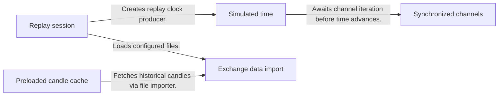
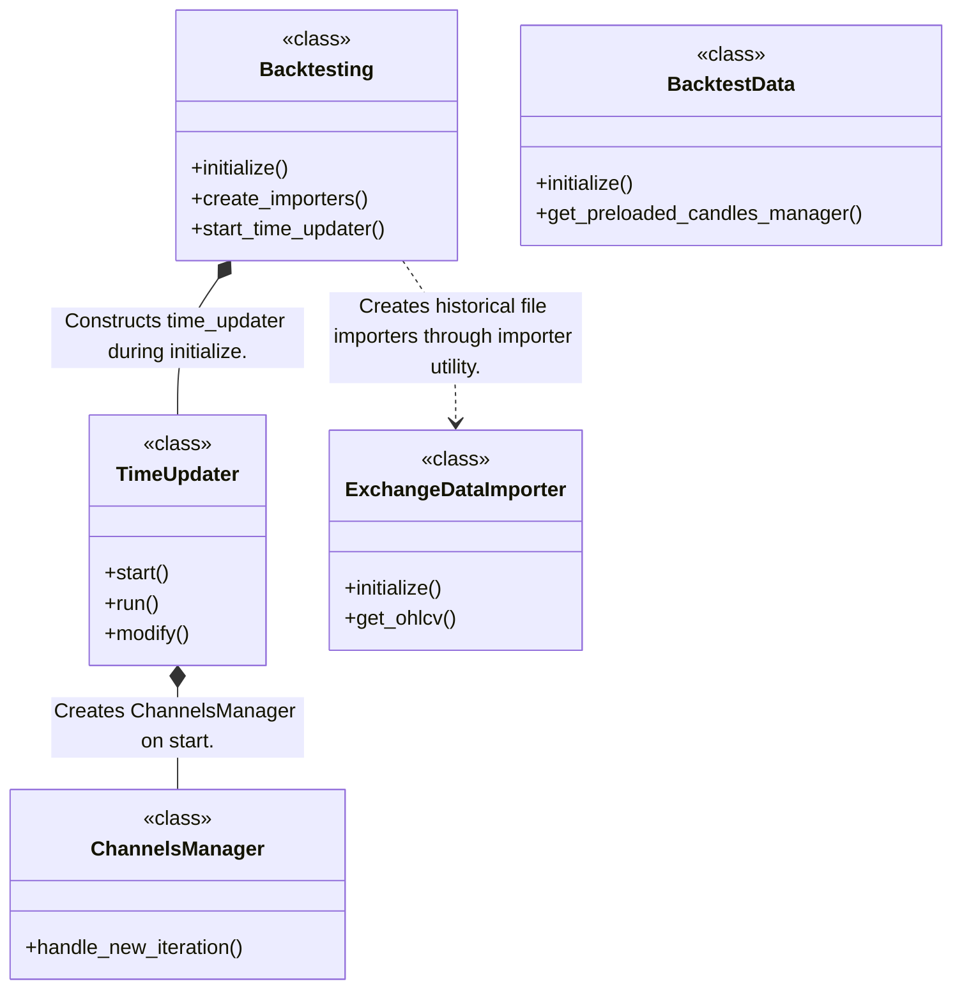
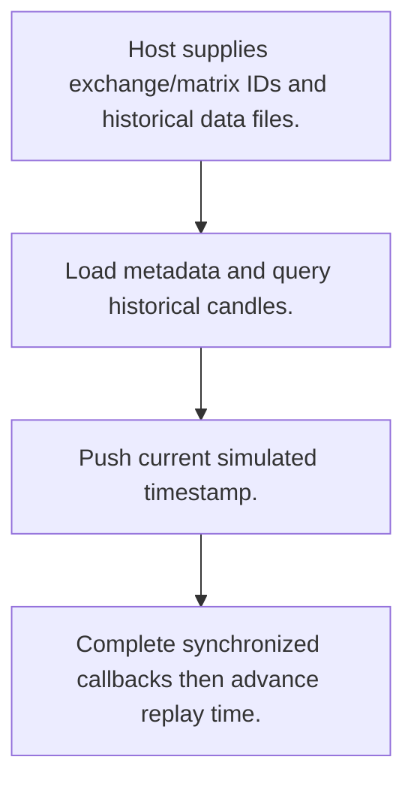
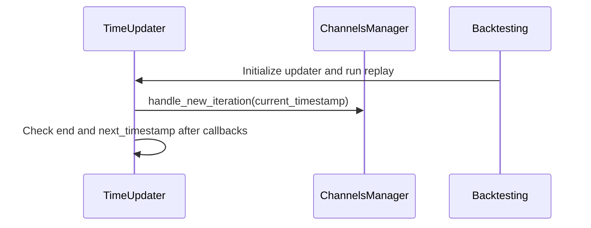

# OctoBot-Backtesting: workflow, design and architecture

Updated: **2026-10-13**
Reviewed Git hash: `00614352fbe4789f0791762aba9ead0883ae52ad`
Branch: `feature/ayu_develop`
Source diff SHA256: `e3b0c44298fc1c149afbf4c8996fb92427ae41e4649b934ca495991b7852b855`
Scope: **Historical replay toolkit** / Maintenance: **companion**
Languages: Python

[HTML edition](ayu-develop.html) / [Development](development.md) / [Historical validation](validation.md) / [Full system comparison](../../docs/index.html)

## Purpose and scope

Load exchange data files and advance a synchronized simulated clock for OctoBot trading/evaluator hosts.

## Features and support boundaries

Native = implemented here. Integration = supplied through a named host/API. Limited = material restriction. Not provided = evidenced scope exclusion. Unverified = support/absence not established. Not applicable = outside this artifact type.

| Capability | Status | Implementation and limits | Source |
|---|---|---|---|
| Backtesting | Native | Historical files and SQLite importers feed a synchronized timestamp-driven replay session. | [Backtesting.initialize](../src/octobot_backtesting/backtesting.py) ([L45](https://github.com/alexcwyu/OctoBot-Backtesting/blob/00614352fbe4789f0791762aba9ead0883ae52ad/src/octobot_backtesting/backtesting.py#L45)) / [ExchangeDataImporter.initialize](../src/octobot_backtesting/importers/exchanges/exchange_importer.py) ([L37](https://github.com/alexcwyu/OctoBot-Backtesting/blob/00614352fbe4789f0791762aba9ead0883ae52ad/src/octobot_backtesting/importers/exchanges/exchange_importer.py#L37)) / [ExchangeDataImporter.get_ohlcv](../src/octobot_backtesting/importers/exchanges/exchange_importer.py) ([L132](https://github.com/alexcwyu/OctoBot-Backtesting/blob/00614352fbe4789f0791762aba9ead0883ae52ad/src/octobot_backtesting/importers/exchanges/exchange_importer.py#L132)) / [TimeUpdater.start](../src/octobot_backtesting/time/channel/time_updater.py) ([L34](https://github.com/alexcwyu/OctoBot-Backtesting/blob/00614352fbe4789f0791762aba9ead0883ae52ad/src/octobot_backtesting/time/channel/time_updater.py#L34)) |
| Live execution | Unverified | Representative source review did not establish this capability; no claim of absence. | Not applicable to this repository scope. |
| Paper trading | Unverified | Representative source review did not establish this capability; no claim of absence. | Not applicable to this repository scope. |
| Event driven | Native | Historical files and SQLite importers feed a synchronized timestamp-driven replay session. | [Backtesting.initialize](../src/octobot_backtesting/backtesting.py) ([L45](https://github.com/alexcwyu/OctoBot-Backtesting/blob/00614352fbe4789f0791762aba9ead0883ae52ad/src/octobot_backtesting/backtesting.py#L45)) / [ExchangeDataImporter.initialize](../src/octobot_backtesting/importers/exchanges/exchange_importer.py) ([L37](https://github.com/alexcwyu/OctoBot-Backtesting/blob/00614352fbe4789f0791762aba9ead0883ae52ad/src/octobot_backtesting/importers/exchanges/exchange_importer.py#L37)) / [ExchangeDataImporter.get_ohlcv](../src/octobot_backtesting/importers/exchanges/exchange_importer.py) ([L132](https://github.com/alexcwyu/OctoBot-Backtesting/blob/00614352fbe4789f0791762aba9ead0883ae52ad/src/octobot_backtesting/importers/exchanges/exchange_importer.py#L132)) / [TimeUpdater.start](../src/octobot_backtesting/time/channel/time_updater.py) ([L34](https://github.com/alexcwyu/OctoBot-Backtesting/blob/00614352fbe4789f0791762aba9ead0883ae52ad/src/octobot_backtesting/time/channel/time_updater.py#L34)) |
| Vectorized | Unverified | Representative source review did not establish this capability; no claim of absence. | Not applicable to this repository scope. |
| Order management | Integration | These are supplied by host trading/evaluator packages consuming replay channels, not implemented by replay clock. | [ChannelsManager.handle_new_iteration](../src/octobot_backtesting/channels_manager.py) ([L82](https://github.com/alexcwyu/OctoBot-Backtesting/blob/00614352fbe4789f0791762aba9ead0883ae52ad/src/octobot_backtesting/channels_manager.py#L82)) / [Backtesting.initialize](../src/octobot_backtesting/backtesting.py) ([L45](https://github.com/alexcwyu/OctoBot-Backtesting/blob/00614352fbe4789f0791762aba9ead0883ae52ad/src/octobot_backtesting/backtesting.py#L45)) |
| Order types | Integration | These are supplied by host trading/evaluator packages consuming replay channels, not implemented by replay clock. | [ChannelsManager.handle_new_iteration](../src/octobot_backtesting/channels_manager.py) ([L82](https://github.com/alexcwyu/OctoBot-Backtesting/blob/00614352fbe4789f0791762aba9ead0883ae52ad/src/octobot_backtesting/channels_manager.py#L82)) / [Backtesting.initialize](../src/octobot_backtesting/backtesting.py) ([L45](https://github.com/alexcwyu/OctoBot-Backtesting/blob/00614352fbe4789f0791762aba9ead0883ae52ad/src/octobot_backtesting/backtesting.py#L45)) |
| Multi venue | Limited | Session accepts multiple exchange IDs and files; host supplies venue-specific trading behavior. | [Backtesting.initialize](../src/octobot_backtesting/backtesting.py) ([L45](https://github.com/alexcwyu/OctoBot-Backtesting/blob/00614352fbe4789f0791762aba9ead0883ae52ad/src/octobot_backtesting/backtesting.py#L45)) / [Backtesting.create_importers](../src/octobot_backtesting/backtesting.py) ([L97](https://github.com/alexcwyu/OctoBot-Backtesting/blob/00614352fbe4789f0791762aba9ead0883ae52ad/src/octobot_backtesting/backtesting.py#L97)) |
| Crypto | Integration | Exchange-oriented replay integrates OctoBot host; market semantics and exchange implementations are external. | [ExchangeDataImporter.initialize](../src/octobot_backtesting/importers/exchanges/exchange_importer.py) ([L37](https://github.com/alexcwyu/OctoBot-Backtesting/blob/00614352fbe4789f0791762aba9ead0883ae52ad/src/octobot_backtesting/importers/exchanges/exchange_importer.py#L37)) |
| Equities | Unverified | Representative source review did not establish this capability; no claim of absence. | Not applicable to this repository scope. |
| Futures | Unverified | Representative source review did not establish this capability; no claim of absence. | Not applicable to this repository scope. |
| Options | Unverified | Representative source review did not establish this capability; no claim of absence. | Not applicable to this repository scope. |
| Forex | Unverified | Representative source review did not establish this capability; no claim of absence. | Not applicable to this repository scope. |
| Strategy api | Integration | These are supplied by host trading/evaluator packages consuming replay channels, not implemented by replay clock. | [ChannelsManager.handle_new_iteration](../src/octobot_backtesting/channels_manager.py) ([L82](https://github.com/alexcwyu/OctoBot-Backtesting/blob/00614352fbe4789f0791762aba9ead0883ae52ad/src/octobot_backtesting/channels_manager.py#L82)) / [Backtesting.initialize](../src/octobot_backtesting/backtesting.py) ([L45](https://github.com/alexcwyu/OctoBot-Backtesting/blob/00614352fbe4789f0791762aba9ead0883ae52ad/src/octobot_backtesting/backtesting.py#L45)) |
| Optimization | Unverified | Representative source review did not establish this capability; no claim of absence. | Not applicable to this repository scope. |
| Machine learning | Unverified | Representative source review did not establish this capability; no claim of absence. | Not applicable to this repository scope. |
| Reinforcement learning | Unverified | Representative source review did not establish this capability; no claim of absence. | Not applicable to this repository scope. |
| Portfolio | Integration | These are supplied by host trading/evaluator packages consuming replay channels, not implemented by replay clock. | [ChannelsManager.handle_new_iteration](../src/octobot_backtesting/channels_manager.py) ([L82](https://github.com/alexcwyu/OctoBot-Backtesting/blob/00614352fbe4789f0791762aba9ead0883ae52ad/src/octobot_backtesting/channels_manager.py#L82)) / [Backtesting.initialize](../src/octobot_backtesting/backtesting.py) ([L45](https://github.com/alexcwyu/OctoBot-Backtesting/blob/00614352fbe4789f0791762aba9ead0883ae52ad/src/octobot_backtesting/backtesting.py#L45)) |
| Risk management | Integration | These are supplied by host trading/evaluator packages consuming replay channels, not implemented by replay clock. | [ChannelsManager.handle_new_iteration](../src/octobot_backtesting/channels_manager.py) ([L82](https://github.com/alexcwyu/OctoBot-Backtesting/blob/00614352fbe4789f0791762aba9ead0883ae52ad/src/octobot_backtesting/channels_manager.py#L82)) / [Backtesting.initialize](../src/octobot_backtesting/backtesting.py) ([L45](https://github.com/alexcwyu/OctoBot-Backtesting/blob/00614352fbe4789f0791762aba9ead0883ae52ad/src/octobot_backtesting/backtesting.py#L45)) |
| Performance analytics | Integration | These are supplied by host trading/evaluator packages consuming replay channels, not implemented by replay clock. | [ChannelsManager.handle_new_iteration](../src/octobot_backtesting/channels_manager.py) ([L82](https://github.com/alexcwyu/OctoBot-Backtesting/blob/00614352fbe4789f0791762aba9ead0883ae52ad/src/octobot_backtesting/channels_manager.py#L82)) / [Backtesting.initialize](../src/octobot_backtesting/backtesting.py) ([L45](https://github.com/alexcwyu/OctoBot-Backtesting/blob/00614352fbe4789f0791762aba9ead0883ae52ad/src/octobot_backtesting/backtesting.py#L45)) |
| Historical data | Native | Historical files and SQLite importers feed a synchronized timestamp-driven replay session. | [Backtesting.initialize](../src/octobot_backtesting/backtesting.py) ([L45](https://github.com/alexcwyu/OctoBot-Backtesting/blob/00614352fbe4789f0791762aba9ead0883ae52ad/src/octobot_backtesting/backtesting.py#L45)) / [ExchangeDataImporter.initialize](../src/octobot_backtesting/importers/exchanges/exchange_importer.py) ([L37](https://github.com/alexcwyu/OctoBot-Backtesting/blob/00614352fbe4789f0791762aba9ead0883ae52ad/src/octobot_backtesting/importers/exchanges/exchange_importer.py#L37)) / [ExchangeDataImporter.get_ohlcv](../src/octobot_backtesting/importers/exchanges/exchange_importer.py) ([L132](https://github.com/alexcwyu/OctoBot-Backtesting/blob/00614352fbe4789f0791762aba9ead0883ae52ad/src/octobot_backtesting/importers/exchanges/exchange_importer.py#L132)) / [TimeUpdater.start](../src/octobot_backtesting/time/channel/time_updater.py) ([L34](https://github.com/alexcwyu/OctoBot-Backtesting/blob/00614352fbe4789f0791762aba9ead0883ae52ad/src/octobot_backtesting/time/channel/time_updater.py#L34)) |
| Streaming data | Unverified | Representative source review did not establish this capability; no claim of absence. | Not applicable to this repository scope. |
| Persistence | Native | Historical files and SQLite importers feed a synchronized timestamp-driven replay session. | [Backtesting.initialize](../src/octobot_backtesting/backtesting.py) ([L45](https://github.com/alexcwyu/OctoBot-Backtesting/blob/00614352fbe4789f0791762aba9ead0883ae52ad/src/octobot_backtesting/backtesting.py#L45)) / [ExchangeDataImporter.initialize](../src/octobot_backtesting/importers/exchanges/exchange_importer.py) ([L37](https://github.com/alexcwyu/OctoBot-Backtesting/blob/00614352fbe4789f0791762aba9ead0883ae52ad/src/octobot_backtesting/importers/exchanges/exchange_importer.py#L37)) / [ExchangeDataImporter.get_ohlcv](../src/octobot_backtesting/importers/exchanges/exchange_importer.py) ([L132](https://github.com/alexcwyu/OctoBot-Backtesting/blob/00614352fbe4789f0791762aba9ead0883ae52ad/src/octobot_backtesting/importers/exchanges/exchange_importer.py#L132)) / [TimeUpdater.start](../src/octobot_backtesting/time/channel/time_updater.py) ([L34](https://github.com/alexcwyu/OctoBot-Backtesting/blob/00614352fbe4789f0791762aba9ead0883ae52ad/src/octobot_backtesting/time/channel/time_updater.py#L34)) |
| Data pipeline | Native | Historical files and SQLite importers feed a synchronized timestamp-driven replay session. | [Backtesting.initialize](../src/octobot_backtesting/backtesting.py) ([L45](https://github.com/alexcwyu/OctoBot-Backtesting/blob/00614352fbe4789f0791762aba9ead0883ae52ad/src/octobot_backtesting/backtesting.py#L45)) / [ExchangeDataImporter.initialize](../src/octobot_backtesting/importers/exchanges/exchange_importer.py) ([L37](https://github.com/alexcwyu/OctoBot-Backtesting/blob/00614352fbe4789f0791762aba9ead0883ae52ad/src/octobot_backtesting/importers/exchanges/exchange_importer.py#L37)) / [ExchangeDataImporter.get_ohlcv](../src/octobot_backtesting/importers/exchanges/exchange_importer.py) ([L132](https://github.com/alexcwyu/OctoBot-Backtesting/blob/00614352fbe4789f0791762aba9ead0883ae52ad/src/octobot_backtesting/importers/exchanges/exchange_importer.py#L132)) / [TimeUpdater.start](../src/octobot_backtesting/time/channel/time_updater.py) ([L34](https://github.com/alexcwyu/OctoBot-Backtesting/blob/00614352fbe4789f0791762aba9ead0883ae52ad/src/octobot_backtesting/time/channel/time_updater.py#L34)) |
| Web ui | Unverified | Representative source review did not establish this capability; no claim of absence. | Not applicable to this repository scope. |
| Cli | Unverified | Representative source review did not establish this capability; no claim of absence. | Not applicable to this repository scope. |
| Monitoring | Unverified | Representative source review did not establish this capability; no claim of absence. | Not applicable to this repository scope. |
| Extension api | Unverified | Representative source review did not establish this capability; no claim of absence. | Not applicable to this repository scope. |
| Native acceleration | Unverified | Representative source review did not establish this capability; no claim of absence. | Not applicable to this repository scope. |
| Distributed execution | Unverified | Representative source review did not establish this capability; no claim of absence. | Not applicable to this repository scope. |

## System components

| Component | Responsibility | Source |
|---|---|---|
| Replay session | Owns exchange/matrix identities and imported files. | [Backtesting.initialize](../src/octobot_backtesting/backtesting.py) ([L45](https://github.com/alexcwyu/OctoBot-Backtesting/blob/00614352fbe4789f0791762aba9ead0883ae52ad/src/octobot_backtesting/backtesting.py#L45)) |
| Simulated time | Publishes and advances replay timestamps. | [TimeUpdater.start](../src/octobot_backtesting/time/channel/time_updater.py) ([L34](https://github.com/alexcwyu/OctoBot-Backtesting/blob/00614352fbe4789f0791762aba9ead0883ae52ad/src/octobot_backtesting/time/channel/time_updater.py#L34)) |
| Exchange data import | Reads typed historical database tables. | [ExchangeDataImporter.initialize](../src/octobot_backtesting/importers/exchanges/exchange_importer.py) ([L37](https://github.com/alexcwyu/OctoBot-Backtesting/blob/00614352fbe4789f0791762aba9ead0883ae52ad/src/octobot_backtesting/importers/exchanges/exchange_importer.py#L37)) |
| Preloaded candle cache | Shares cached candle managers among replay consumers. | [BacktestData.get_preloaded_candles_manager](../src/octobot_backtesting/backtest_data.py) ([L23](https://github.com/alexcwyu/OctoBot-Backtesting/blob/00614352fbe4789f0791762aba9ead0883ae52ad/src/octobot_backtesting/backtest_data.py#L23)) |
| Synchronized channels | Coordinates producer priorities and iteration completion. | [ChannelsManager.handle_new_iteration](../src/octobot_backtesting/channels_manager.py) ([L82](https://github.com/alexcwyu/OctoBot-Backtesting/blob/00614352fbe4789f0791762aba9ead0883ae52ad/src/octobot_backtesting/channels_manager.py#L82)) |

## Architecture and component boundaries

The component view summarizes inspected responsibility boundaries. Arrows identify the documented API/data dependencies; this is not a deployment-readiness claim.

- Creates replay clock producer.: [Backtesting.initialize](../src/octobot_backtesting/backtesting.py) ([L45](https://github.com/alexcwyu/OctoBot-Backtesting/blob/00614352fbe4789f0791762aba9ead0883ae52ad/src/octobot_backtesting/backtesting.py#L45))
- Loads configured files.: [Backtesting.create_importers](../src/octobot_backtesting/backtesting.py) ([L97](https://github.com/alexcwyu/OctoBot-Backtesting/blob/00614352fbe4789f0791762aba9ead0883ae52ad/src/octobot_backtesting/backtesting.py#L97))
- Awaits channel iteration before time advances.: [TimeUpdater.start](../src/octobot_backtesting/time/channel/time_updater.py) ([L34](https://github.com/alexcwyu/OctoBot-Backtesting/blob/00614352fbe4789f0791762aba9ead0883ae52ad/src/octobot_backtesting/time/channel/time_updater.py#L34))
- Fetches historical candles via file importer.: [BacktestData.get_preloaded_candles_manager](../src/octobot_backtesting/backtest_data.py) ([L23](https://github.com/alexcwyu/OctoBot-Backtesting/blob/00614352fbe4789f0791762aba9ead0883ae52ad/src/octobot_backtesting/backtest_data.py#L23))

## Design decisions

| Decision | Rationale | Tradeoff | Evidence |
|---|---|---|---|
| Synchronize channels before advancing time. | Keeps simulated callbacks on a shared historical clock. | Replay waits for participating producer processing rather than evaluating all trades as a vectorized portfolio kernel. | [TimeUpdater.start](../src/octobot_backtesting/time/channel/time_updater.py) ([L34](https://github.com/alexcwyu/OctoBot-Backtesting/blob/00614352fbe4789f0791762aba9ead0883ae52ad/src/octobot_backtesting/time/channel/time_updater.py#L34)) |

## Class and interface relationships

Each node is a reviewed source symbol. Function/module nodes are explicitly labeled; they do not imply Python classes. Only reviewed relationships are drawn.

- **Backtesting** (class): [Backtesting.initialize](../src/octobot_backtesting/backtesting.py) ([L45](https://github.com/alexcwyu/OctoBot-Backtesting/blob/00614352fbe4789f0791762aba9ead0883ae52ad/src/octobot_backtesting/backtesting.py#L45))
- **TimeUpdater** (class): [TimeUpdater.start](../src/octobot_backtesting/time/channel/time_updater.py) ([L34](https://github.com/alexcwyu/OctoBot-Backtesting/blob/00614352fbe4789f0791762aba9ead0883ae52ad/src/octobot_backtesting/time/channel/time_updater.py#L34))
- **ExchangeDataImporter** (class): [ExchangeDataImporter.initialize](../src/octobot_backtesting/importers/exchanges/exchange_importer.py) ([L37](https://github.com/alexcwyu/OctoBot-Backtesting/blob/00614352fbe4789f0791762aba9ead0883ae52ad/src/octobot_backtesting/importers/exchanges/exchange_importer.py#L37))
- **BacktestData** (class): [BacktestData.get_preloaded_candles_manager](../src/octobot_backtesting/backtest_data.py) ([L23](https://github.com/alexcwyu/OctoBot-Backtesting/blob/00614352fbe4789f0791762aba9ead0883ae52ad/src/octobot_backtesting/backtest_data.py#L23))
- **ChannelsManager** (class): [ChannelsManager.handle_new_iteration](../src/octobot_backtesting/channels_manager.py) ([L82](https://github.com/alexcwyu/OctoBot-Backtesting/blob/00614352fbe4789f0791762aba9ead0883ae52ad/src/octobot_backtesting/channels_manager.py#L82))

## Workflow

### Host historical replay

Host integration supplies trading decisions, orders and final analytics; this toolkit is not a standalone broker engine.

1. Host supplies exchange/matrix IDs and historical data files.. [Backtesting.initialize](../src/octobot_backtesting/backtesting.py) ([L45](https://github.com/alexcwyu/OctoBot-Backtesting/blob/00614352fbe4789f0791762aba9ead0883ae52ad/src/octobot_backtesting/backtesting.py#L45)) / [Backtesting.create_importers](../src/octobot_backtesting/backtesting.py) ([L97](https://github.com/alexcwyu/OctoBot-Backtesting/blob/00614352fbe4789f0791762aba9ead0883ae52ad/src/octobot_backtesting/backtesting.py#L97))
2. Load metadata and query historical candles.. [ExchangeDataImporter.initialize](../src/octobot_backtesting/importers/exchanges/exchange_importer.py) ([L37](https://github.com/alexcwyu/OctoBot-Backtesting/blob/00614352fbe4789f0791762aba9ead0883ae52ad/src/octobot_backtesting/importers/exchanges/exchange_importer.py#L37)) / [ExchangeDataImporter.get_ohlcv](../src/octobot_backtesting/importers/exchanges/exchange_importer.py) ([L132](https://github.com/alexcwyu/OctoBot-Backtesting/blob/00614352fbe4789f0791762aba9ead0883ae52ad/src/octobot_backtesting/importers/exchanges/exchange_importer.py#L132))
3. Push current simulated timestamp.. [TimeUpdater.start](../src/octobot_backtesting/time/channel/time_updater.py) ([L34](https://github.com/alexcwyu/OctoBot-Backtesting/blob/00614352fbe4789f0791762aba9ead0883ae52ad/src/octobot_backtesting/time/channel/time_updater.py#L34))
4. Complete synchronized callbacks then advance replay time.. [TimeUpdater.start](../src/octobot_backtesting/time/channel/time_updater.py) ([L34](https://github.com/alexcwyu/OctoBot-Backtesting/blob/00614352fbe4789f0791762aba9ead0883ae52ad/src/octobot_backtesting/time/channel/time_updater.py#L34)) / [ChannelsManager.handle_new_iteration](../src/octobot_backtesting/channels_manager.py) ([L82](https://github.com/alexcwyu/OctoBot-Backtesting/blob/00614352fbe4789f0791762aba9ead0883ae52ad/src/octobot_backtesting/channels_manager.py#L82))

## Sequence

Replay iteration

- Initialize updater and run replay: [Backtesting.initialize](../src/octobot_backtesting/backtesting.py) ([L45](https://github.com/alexcwyu/OctoBot-Backtesting/blob/00614352fbe4789f0791762aba9ead0883ae52ad/src/octobot_backtesting/backtesting.py#L45))
- handle_new_iteration(current_timestamp): [TimeUpdater.start](../src/octobot_backtesting/time/channel/time_updater.py) ([L34](https://github.com/alexcwyu/OctoBot-Backtesting/blob/00614352fbe4789f0791762aba9ead0883ae52ad/src/octobot_backtesting/time/channel/time_updater.py#L34)) / [ChannelsManager.handle_new_iteration](../src/octobot_backtesting/channels_manager.py) ([L82](https://github.com/alexcwyu/OctoBot-Backtesting/blob/00614352fbe4789f0791762aba9ead0883ae52ad/src/octobot_backtesting/channels_manager.py#L82))
- Check end and next_timestamp after callbacks: [TimeUpdater.start](../src/octobot_backtesting/time/channel/time_updater.py) ([L34](https://github.com/alexcwyu/OctoBot-Backtesting/blob/00614352fbe4789f0791762aba9ead0883ae52ad/src/octobot_backtesting/time/channel/time_updater.py#L34))

## Strengths and limits

### Strengths

- Reusable importer mapping and preloaded candle managers avoid forcing each replay consumer to re-read files. [Backtesting.create_importers](../src/octobot_backtesting/backtesting.py) ([L97](https://github.com/alexcwyu/OctoBot-Backtesting/blob/00614352fbe4789f0791762aba9ead0883ae52ad/src/octobot_backtesting/backtesting.py#L97)) / [BacktestData.get_preloaded_candles_manager](../src/octobot_backtesting/backtest_data.py) ([L23](https://github.com/alexcwyu/OctoBot-Backtesting/blob/00614352fbe4789f0791762aba9ead0883ae52ad/src/octobot_backtesting/backtest_data.py#L23))

### Limitations

- Accurate price-timeframe mode requires importer full-timeframe candle history; missing coverage returns false. [Backtesting.use_accurate_price_time_frame](../src/octobot_backtesting/backtesting.py) ([L65](https://github.com/alexcwyu/OctoBot-Backtesting/blob/00614352fbe4789f0791762aba9ead0883ae52ad/src/octobot_backtesting/backtesting.py#L65))

## Validation scope

The linked validation and command records preserve actual historical runs and user-authorized exclusions. This source/document review does not rerun application tests, establish live trading readiness or rank benchmark performance. Current data, credential and runtime prerequisites remain material.

[Repository validation](validation.md) / [Executed checks](maintenance/index.md)

## Source map

| Reviewed symbol/path | Inspected responsibility | Actual file SHA256 |
|---|---|---|
| [Backtesting.initialize](../src/octobot_backtesting/backtesting.py) ([L45](https://github.com/alexcwyu/OctoBot-Backtesting/blob/00614352fbe4789f0791762aba9ead0883ae52ad/src/octobot_backtesting/backtesting.py#L45)) | Constructs TimeManager, synchronized TimeChannel and TimeUpdater. | `79a15bfb766a2d5602d4598598a41b91443a263132799fc9a2aaa91c7fe8ede2` |
| [Backtesting.create_importers](../src/octobot_backtesting/backtesting.py) ([L97](https://github.com/alexcwyu/OctoBot-Backtesting/blob/00614352fbe4789f0791762aba9ead0883ae52ad/src/octobot_backtesting/backtesting.py#L97)) | Reuses supplied importer mapping or constructs importer for each historical file. | `79a15bfb766a2d5602d4598598a41b91443a263132799fc9a2aaa91c7fe8ede2` |
| [TimeUpdater.start](../src/octobot_backtesting/time/channel/time_updater.py) ([L34](https://github.com/alexcwyu/OctoBot-Backtesting/blob/00614352fbe4789f0791762aba9ead0883ae52ad/src/octobot_backtesting/time/channel/time_updater.py#L34)) | Pushes timestamp, awaits synchronous channel callbacks, checks completion and advances timestamp before next iteration. | `93686d7f61aef19a9b921533efa6e0a3cd323ce4c3d8e5e424bfe1733c5d6582` |
| [ExchangeDataImporter.initialize](../src/octobot_backtesting/importers/exchanges/exchange_importer.py) ([L37](https://github.com/alexcwyu/OctoBot-Backtesting/blob/00614352fbe4789f0791762aba9ead0883ae52ad/src/octobot_backtesting/importers/exchanges/exchange_importer.py#L37)) | Loads SQLite description, exchange name, symbols, timeframes and available data tables. | `39b2f10d13132f4dfd7c49eab5163d4092b3d8957aae2f1f4d8d109b127af539` |
| [ExchangeDataImporter.get_ohlcv](../src/octobot_backtesting/importers/exchanges/exchange_importer.py) ([L132](https://github.com/alexcwyu/OctoBot-Backtesting/blob/00614352fbe4789f0791762aba9ead0883ae52ad/src/octobot_backtesting/importers/exchanges/exchange_importer.py#L132)) | Reads filtered OHLCV table through database adapter and converts rows. | `39b2f10d13132f4dfd7c49eab5163d4092b3d8957aae2f1f4d8d109b127af539` |
| [BacktestData.get_preloaded_candles_manager](../src/octobot_backtesting/backtest_data.py) ([L23](https://github.com/alexcwyu/OctoBot-Backtesting/blob/00614352fbe4789f0791762aba9ead0883ae52ad/src/octobot_backtesting/backtest_data.py#L23)) | Looks up and caches preloaded historical candles managers by exchange/symbol/timeframe. | `0102d93b884dfa9f9d673110a50c0227916535ab851298b0758787dcb99d3b2c` |
| [ChannelsManager.handle_new_iteration](../src/octobot_backtesting/channels_manager.py) ([L82](https://github.com/alexcwyu/OctoBot-Backtesting/blob/00614352fbe4789f0791762aba9ead0883ae52ad/src/octobot_backtesting/channels_manager.py#L82)) | Runs synchronized producer processing for current simulated iteration. | `dd2085c08d5f10960b8a9329e92e0863be424eec1d90c3457fec2be33893b523` |
| [Backtesting.use_accurate_price_time_frame](../src/octobot_backtesting/backtesting.py) ([L65](https://github.com/alexcwyu/OctoBot-Backtesting/blob/00614352fbe4789f0791762aba9ead0883ae52ad/src/octobot_backtesting/backtesting.py#L65)) | Returns false if any importer lacks all-timeframe candle history, otherwise uses supplied backtest data accuracy setting or true. | `79a15bfb766a2d5602d4598598a41b91443a263132799fc9a2aaa91c7fe8ede2` |

## Documentation provenance

Review date: 2026-10-13. Full committed source HEAD: `00614352fbe4789f0791762aba9ead0883ae52ad`. Template version: 2. 5 source files were independently hashed for this guide.

[Evidence catalog](../../docs/systems-2026-10-13/catalog.json) / [Standard template](../../docs/guidelines/APP_TEMPLATE.md)

- Read-only source audit of inventory HEAD 00614352fbe4789f0791762aba9ead0883ae52ad; no runtime execution, credential check or live-production assertion. Existing validation records remain separate historical evidence.
- Inspected implementation/configuration coverage: src/octobot_backtesting/backtesting.py, src/octobot_backtesting/time/channel/time_updater.py, src/octobot_backtesting/importers/exchanges/exchange_importer.py, src/octobot_backtesting/backtest_data.py, src/octobot_backtesting/channels_manager.py
- Source symbols and call chains are representative coverage, not exhaustive connector, strategy or product certification. Integration statuses identify dependencies that supply the runtime behavior.
