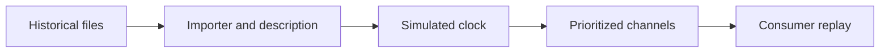
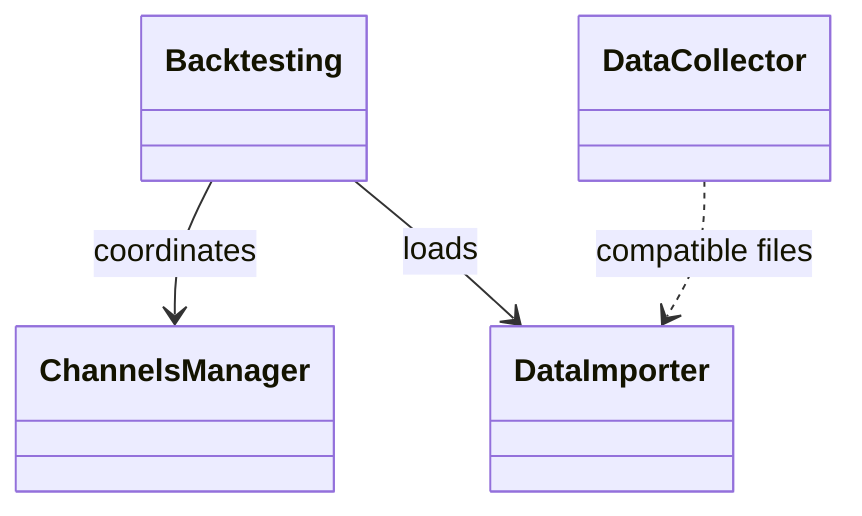
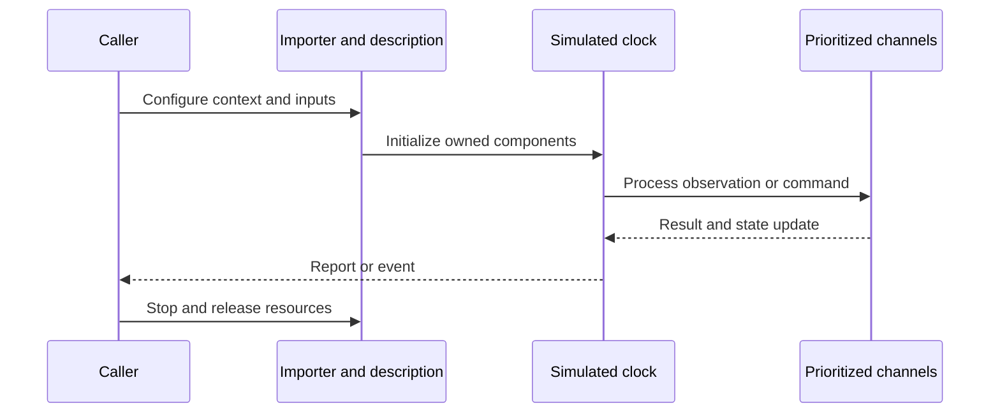
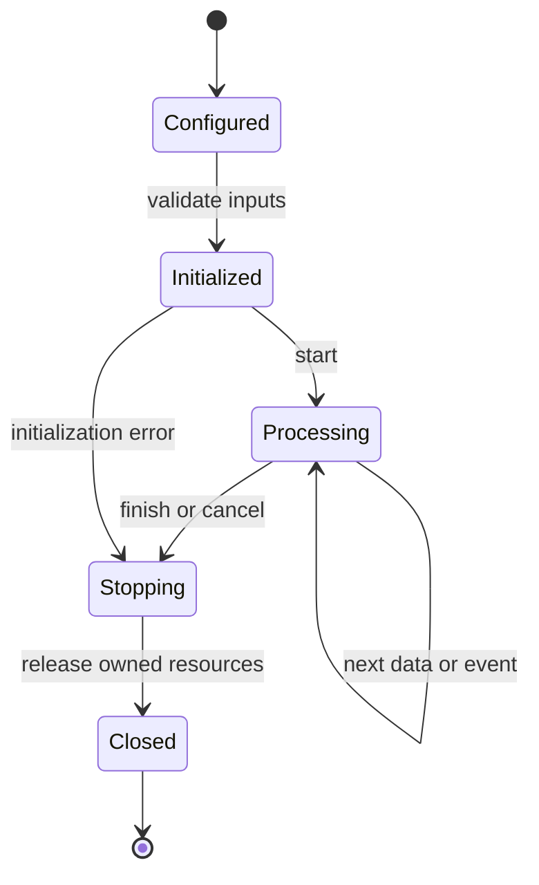
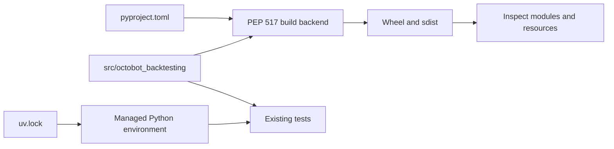
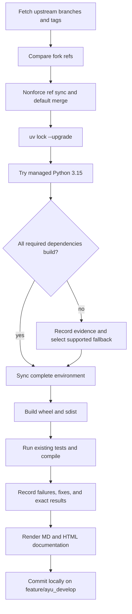

# OctoBot-Backtesting: architecture and development

Backtesting imports historical market/social data and advances channel producers using a simulated clock. It supplies data collection and replay infrastructure; the strategy and exchange simulation are supplied by the surrounding OctoBot runtime.

## Components and boundaries

Backtesting owns replay initialization and lifecycle. ChannelsManager coordinates producers and consumers, while the time channel controls when historical events become visible. DataImporter implementations read storage records; DataCollector implementations capture live or historical records. Format enums and converters keep import/collection compatible without exposing file schema details to strategy callers.

The following class view names implementation classes. Cross-package types are supplied by the host ecosystem; arrows describe inheritance or usage, not copied ownership.

## Runtime workflow

Select files and requested symbols/time frames, inspect their descriptions, create importers, initialize time/channel managers, replay data in timestamp order, and stop all resources. Collectors perform the inverse path: obtain exchange or social data, normalize it, write a data file, and finalize the export.

This sequence is an architectural view of responsibility and resource ownership. Individual plugin, connector, and strategy implementations can add asynchronous events and error branches. The lifecycle below is a conceptual operating workflow, rather than a claim that every component has one shared state enum.

## Features and extension points

Historical and live exchange collectors; social data collectors/importers; timestamp-controlled replay; channel priority synchronization; data-file descriptions; converter APIs and explicit incompatibility errors.

Extend the owning component behind its existing public interface. Keep metadata and configuration alongside plugin/strategy resources. Exchange-specific behavior belongs in an adapter; strategy decisions belong in the strategy/evaluator layer; persistence schema and migrations belong with the storage implementation. Review the source map below before changing a boundary, and exercise the existing tests associated with that boundary.

## Packaging and dependency design

Uses the sibling Commons source through uv, keeping the shared resource/API corrections in the actual installed environment. Existing 19 tests exercise the public replay and collector paths; Python 3.15 is usable.

The lock records exact package versions, hashes, platform markers, and local source mappings. Path sources deliberately bind related repositories in this workspace; clone sibling repositories at the documented names before synchronization. Published packaging metadata describes public dependencies, while uv source settings select this development workspace. Resolve dependency changes with uv lock --upgrade and retain the generated lock, then verify the same locked environment.

## Maintenance workflow

All upstream branches and tags are fetched. Fork updates use nonforce pushes; a divergent branch is merged without erasing fork history. The default branch is merged into feature/ayu_develop with package/resource conflicts reconciled in their installed locations. Build and test evidence is recorded before a local maintenance commit. Feature branch publication is a separate root-level action.

No existing test assertions are removed and no new test cases are introduced in this maintenance pass. Corrected fixtures preserve coverage while making paths, corruption inputs, and resource cleanup compatible with the selected interpreter. A failed test or unsupported dependency is reported explicitly in [validation](validation.md); package build success does not imply strategy correctness, profitability, or successful live connectivity.

## Source map

| Source | Responsibility and location |
| --- | --- |
| [backtesting.py](../src/octobot_backtesting/backtesting.py) | src/octobot_backtesting/backtesting.py |
| [channels_manager.py](../src/octobot_backtesting/channels_manager.py) | src/octobot_backtesting/channels_manager.py |
| [backtest_data.py](../src/octobot_backtesting/backtest_data.py) | src/octobot_backtesting/backtest_data.py |
| [data_importer.py](../src/octobot_backtesting/importers/data_importer.py) | src/octobot_backtesting/importers/data_importer.py |
| [exchange_importer.py](../src/octobot_backtesting/importers/exchanges/exchange_importer.py) | src/octobot_backtesting/importers/exchanges/exchange_importer.py |
| [data_collector.py](../src/octobot_backtesting/collectors/data_collector.py) | src/octobot_backtesting/collectors/data_collector.py |
| [exchange_collector.py](../src/octobot_backtesting/collectors/exchanges/exchange_collector.py) | src/octobot_backtesting/collectors/exchanges/exchange_collector.py |
| [data_file_manager.py](../src/octobot_backtesting/data/data_file_manager.py) | src/octobot_backtesting/data/data_file_manager.py |
| [time_manager.py](../src/octobot_backtesting/time/time_manager.py) | src/octobot_backtesting/time/time_manager.py |
| [backtesting.py](../src/octobot_backtesting/api/backtesting.py) | src/octobot_backtesting/api/backtesting.py |
| [pyproject.toml](../pyproject.toml) | pyproject.toml |
| [uv.lock](../uv.lock) | uv.lock |
| [README.md](../README.md) | README.md |

## Further reading

Use [development.md](development.md) for reproducible commands and [validation.md](validation.md) for exact interpreter, dependency, build, test, and blocker evidence. The equivalent [HTML architecture document](ayu-develop.html) supports browsing and rendered diagrams.
